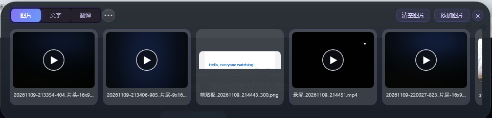

# Myriad Isle · 万象岛

**English** | [简体中文](README.md)

> A "Dynamic Island" capsule for Windows: capture screenshots, annotate them, and translate any region of your screen — in a single 486 KB executable.



<p align="center">
  
  
  
  
</p>

> ⭐ If this tool saves you time, a star helps others find it — that is the only "payment" this project asks for.

---

## What is it

A slim capsule pinned to the top edge of your desktop. Screenshots drop straight into it, a hotkey turns it into a region translator, and any text you copy is collected automatically.

**One executable. No installer. No cloud.**

## Features

| Module | What it does |
| --- | --- |
| 📸 **Capture** | Region / window / full screen; the image lands in the capsule with no popup |
| 🖼️ **Image shelf** | Hover to preview, click to open, drag straight into WeChat / QQ / Explorer |
| ✏️ **Annotate** | Rect, ellipse, arrow, pen, highlighter, text, callout, numbered steps, blur, mosaic, crop |
| 📝 **Text** | Copied text is collected into the capsule |
| 🌐 **Translate** | Text translation and region translation (OCR + overlay); free MyMemory or your own AI model |
| 💬 **WeChat / QQ** | Unread hint beside the capsule |
| 🎬 **Recorder** | One-key MP4 recording via ffmpeg |
| 🎞️ **Video** | Videos in the capsule can be played in place |

## Download

**Get the latest zip from [Releases](https://github.com/pl514/myriad-isle/releases/latest).**

```
1. Download  MyriadIsle-3.20.zip  (~0.3 MB)
2. Extract anywhere
3. Double-click  MyriadIsle.exe
4. A capsule appears at the top of your screen
```

Requirements: Windows 10 / 11 (64-bit) with .NET Framework 4.8. Optional: ffmpeg for recording.

The executable is not code-signed, so antivirus software may warn on first run — add the folder to your trusted list.

## Hotkeys

Configurable via the tray menu.

| Action | Default |
| --- | --- |
| Show / hide capsule | `Ctrl + Alt + Shift + Space` |
| Region capture | `Ctrl + Alt + Shift + A` |
| Window capture | `Ctrl + Alt + Shift + 2` |
| Full-screen capture | `Ctrl + Alt + Shift + 3` |
| Collapse / expand images | `Ctrl + Alt + Shift + H` |
| Start / stop recording | `Ctrl + Alt + Shift + R` |
| Region translate | `Ctrl + Alt + Shift + F` |

## Data & privacy

Everything is local, in `data\` next to the executable. Portable: copy the folder to migrate, delete `data\` to reset.

## Standard vs Pro

| | Standard (this repo) | [Pro](https://github.com/pl514/myriad-isle-pro) |
| --- | --- | --- |
| Size | 486 KB single file | ~1 MB + WebView2 |
| Capture / edit / translate | ✅ | ✅ |
| WeChat / QQ hints | ✅ | ✅ |
| Recorder | ✅ | ✅ |
| Douyin floating window | — | ✅ |
| Music panel / desktop lyrics | — | ✅ |
| AI assistant panel | — | ✅ |

## Build from source

```powershell
.\Build.ps1
```

Output: `build\MyriadIsle.exe` (requires the `csc.exe` bundled with .NET Framework 4.8).

## License

[MIT](LICENSE) · [Disclaimer](DISCLAIMER.md)
