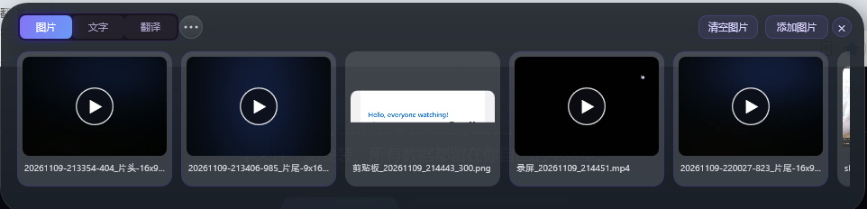

# 万象岛 · Myriad Isle

> 常驻桌面顶部的 Windows「动态岛」胶囊：截图、编辑、翻译，一个文件就够。



<p align="center">
  
  
  
  
  
</p>

---

## 这是什么

**万象岛** 是一个贴在屏幕顶部的胶囊小条，像手机上的「灵动岛」：

- 截图后，图片**自动吸进胶囊**，点开能看、能改、能直接拖进微信 / QQ / 文件夹
- 按一下热键，框住屏幕任意区域，**就地翻译**成中文
- 复制任何文字，它自动收进胶囊，随时找回来

整个程序**只有一个 exe（约 486 KB）**，不需要安装、不需要 .NET 之外的任何运行库。

## 功能一览

| 模块 | 能做什么 |
| --- | --- |
| 📸 **截图** | 区域 / 窗口 / 全屏，截完自动落进胶囊 |
| 🖼️ **图片管理** | 胶囊里横向排列，悬停放大，单击预览，右键菜单，可拖拽到其它程序 |
| ✏️ **图片编辑** | 矩形、椭圆、箭头、画笔、荧光笔、文字、气泡、步骤序号、模糊、马赛克、裁剪、撤销重做 |
| 📝 **文字** | 复制任意文字自动收进胶囊，可复制、清空、翻译 |
| 🌐 **翻译** | 文本翻译 + **屏幕框选翻译**；引擎可切：免费 MyMemory / 自己的 AI 模型 |
| 💬 **微信 / QQ 提示** | 有新消息时胶囊冒出提示条，点击直达对应窗口 |
| 🎬 **录屏** | 一键录 MP4（需要 ffmpeg） |
| 🎞️ **视频播放** | 胶囊里的视频可直接播放 |

## 界面展示

### 胶囊本体

<p align="center">
  
</p>

平时就是顶部一条窄窄的小条，不挡视线；鼠标移上去或按热键就展开成面板。

### 展开后的面板

三个页签：**图片 / 文字 / 翻译**，图片以卡片横向排列，滚轮翻页。

## 下载与安装

**去 [Releases](https://github.com/pl514/myriad-isle/releases/latest) 下载最新 zip。**

```
1. 下载  MyriadIsle-3.20.zip（约 0.31 MB）
2. 解压到任意文件夹
3. 双击  MyriadIsle.exe
4. 屏幕顶部出现胶囊，完事
```

### 系统要求

| 项目 | 要求 |
| --- | --- |
| 系统 | Windows 10 / 11（64 位） |
| 运行时 | .NET Framework 4.8（Win10 1903+ / Win11 自带） |
| 录屏（可选） | ffmpeg，放到程序目录或加入 PATH |

### 关于杀毒软件

程序没有代码签名证书，首次运行可能被 Defender / 360 / 火绒拦一下。把文件夹加入信任即可。

## 五分钟上手

1. **截图**：`Ctrl + Alt + Shift + A` 框选区域 → 松手，图片进胶囊
2. **改图**：单击胶囊里的图片 → 预览 → 编辑
3. **用图**：把图片从胶囊拖进微信 / QQ / 文件夹，或右键复制
4. **翻译**：`Ctrl + Alt + Shift + F` → 框住要翻译的地方 → 自动识别并覆盖成中文

## 热键表

全部可以在「托盘右键 → 热键设置」里改。

| 功能 | 默认热键 |
| --- | --- |
| 显示 / 收起胶囊 | `Ctrl + Alt + Shift + Space` |
| 区域截图 | `Ctrl + Alt + Shift + A` |
| 窗口截图 | `Ctrl + Alt + Shift + 2` |
| 全屏截图 | `Ctrl + Alt + Shift + 3` |
| 收起 / 展开图片 | `Ctrl + Alt + Shift + H` |
| 开始 / 停止录屏 | `Ctrl + Alt + Shift + R` |
| 屏幕翻译 | `Ctrl + Alt + Shift + F` |

## 数据与隐私

**所有数据都在本地，程序不会上传任何东西**（除非你主动使用翻译服务）。

```
MyriadIsle.exe
data\
├── images\        截图与图片
├── screenshots\   剪贴板图片
├── Recordings\    录屏
├── translate-img\ 图片翻译结果
├── settings.txt   设置
└── hotkeys.txt    改过的热键
```

- 迁移：整个文件夹复制走（绿色软件）
- 清空：删 `data\` 重来
- 开机自启：托盘菜单开关，写当前用户注册表 Run 项，不弹 UAC

## 和 Pro 版的区别

| | 标准版（本仓库） | [Pro 版](https://github.com/pl514/myriad-isle-pro) |
| --- | --- | --- |
| 体积 | 单文件 486 KB | 约 1 MB + WebView2 运行库 |
| 截图 / 编辑 / 翻译 | ✅ | ✅ |
| 微信 / QQ 提示 | ✅ | ✅ |
| 录屏 | ✅ | ✅ |
| 抖音置顶小窗 | — | ✅ |
| 音乐面板 / 桌面歌词 | — | ✅ |
| AI 问答面板 | — | ✅ |
| 三点球快捷入口 | — | ✅ |

想要更轻、够用 → 标准版；想要抖音小窗、音乐、歌词投射 → 装 Pro 版。

## 常见问题

<details>
<summary><b>双击没反应</b></summary>

多半是杀软拦截。把文件夹加入信任再试；也可以右键属性确认文件没被删。
</details>

<details>
<summary><b>拖图片到微信失败</b></summary>

Windows 不允许低权限进程给高权限进程拖文件。请用**普通权限**运行（不要「以管理员身份运行」）。
</details>

<details>
<summary><b>翻译提示配额用完</b></summary>

MyMemory 免费额度按天计算。可等一会儿，或在设置里换成自己的 AI 模型（DeepSeek、智谱等有免费额度）。
</details>

<details>
<summary><b>热键没反应</b></summary>

可能被输入法或其它软件占用，在热键设置里换一组即可。
</details>

## 从源码构建

不需要 Visual Studio，也不用 NuGet：

```powershell
.\Build.ps1
```

产物固定为 `build\MyriadIsle.exe`（需要 .NET Framework 4.8 自带的 `csc.exe`）。

### 打发布包

```powershell
.\Publish.ps1
```

输出 `publish\万象岛-3.20.zip`，含 exe 与使用说明。

## 许可与免责

本项目使用 [MIT](LICENSE) 许可。

使用前请阅读 **[免责声明](DISCLAIMER.md)**，想参与开发看 **[贡献指南](CONTRIBUTING.md)**。
